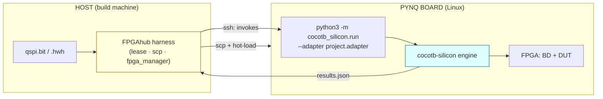
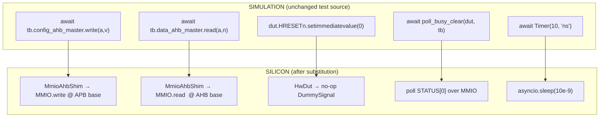
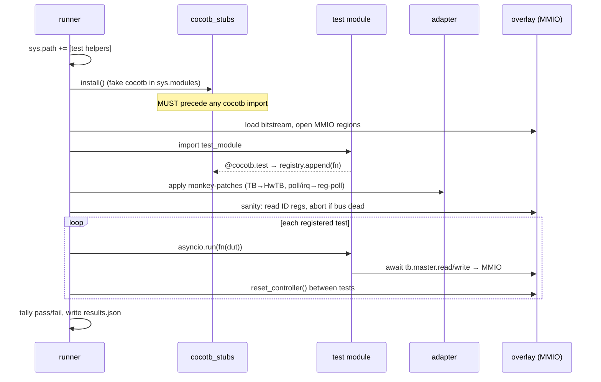
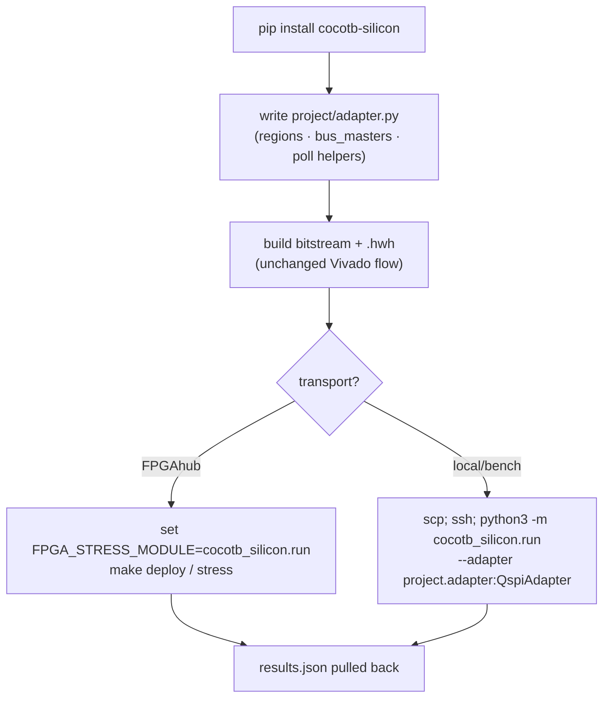

# cocotb-silicon — design & extraction proposal

**Status:** implemented. The standalone package now lives in the sibling
repo `cocotb-silicon` (initial commit done). This repo consumes it via
[`pynq/cocotb_silicon_adapter.py`](../pynq/cocotb_silicon_adapter.py) +
[`pynq/run_cocotb_silicon.py`](../pynq/run_cocotb_silicon.py), driven by
`make -C fpga cocotb_hw`. The legacy [`pynq/tests/`](../pynq/tests/) and
[`pynq/stress/`](../pynq/stress/) paths are intentionally left in place
until the on-board parity regression (§8 step 5) is signed off. Package
internals are explained in `cocotb-silicon/docs/` (how-pynq / how-cocotb /
how-the-interface).

**Goal:** extract the cocotb-replay layer in [`pynq/`](../pynq/) into a standalone,
pip-installable package (`cocotb-silicon`) that any cocotb-based hardware
project can `pip install` and adopt by writing a single small *adapter*
file — turning "run my sim suite on real silicon" into a seamless,
project-agnostic capability that composes with (but does not depend on)
FPGAhub.

---

## 1. The one-sentence summary

The thing that makes this project's sim tests run on hardware is **not**
the QSPI logic — it is a generic trick: *inject fake `cocotb` modules
into `sys.modules` before the test file is imported, let the
`@cocotb.test` decorator self-register the tests, then monkey-patch the
testbench's bus-master and DUT objects so every `await master.read/write`
lands on a real MMIO aperture instead of a simulator.* Nothing about
that trick is QSPI-specific. About **75% of [`pynq/`](../pynq/) is
already project-agnostic** and can move into a library; the remaining
~25% is a declarative *adapter* each project writes once.

---

## 2. Why a standalone package (and where the seam with FPGAhub is)

FPGAhub answers *"which board, and how do I get my bitstream onto it?"*
cocotb-silicon answers *"how does my unmodified sim suite execute once
the bitstream is loaded?"* These are orthogonal. Keeping them as
separate packages that meet at a **CLI contract** keeps each reusable on
its own:



**The seam is the single command `python3 -m cocotb_silicon.run
--adapter <module>` plus a JSON result file.** FPGAhub's existing
[`run_stress.sh`](../fpga/harness/scripts/run_stress.sh) /
[`fpga.mk`](../fpga/harness/fpga.mk) already shell out to exactly this
shape (`ssh … sudo python3 -m <module> --budget N`, then scp results
back), so no FPGAhub change is required to consume the package — only a
`FPGA_STRESS_MODULE = cocotb_silicon.run` style wire-up. A project that
does *not* use FPGAhub (local JTAG, a lab bench board) still gets the
full replay engine; it just invokes the same CLI by hand.

> **Consequence:** `cocotb-silicon` must depend on **nothing**
> FPGAhub-specific. Its only runtime deps are the Python stdlib and,
> optionally, `pynq` (with a stdlib `/dev/mem` fallback when `pynq` is
> unavailable — that fallback already exists as
> [`bare_overlay.py`](../pynq/bare_overlay.py)).

---

## 3. Under the hood: the three mechanisms

The replay engine is three cooperating tricks. Understanding them is the
prerequisite for drawing the extraction boundary correctly.

### 3.1 Mechanism A — stub injection before import

A cocotb test file does `import cocotb`, `from cocotb.triggers import
Timer`, `from cocotbext.ahb import AHBLiteMaster` at module load. On a
board there is no simulator and these packages aren't installed. So
**before** the test module is imported, fake modules are pushed into
`sys.modules` (see [`cocotb_stubs.py`](../pynq/cocotb_stubs.py)):

| Real cocotb object | Stub behaviour |
|---|---|
| `@cocotb.test` | Append the coroutine to a registry list, return it unchanged |
| `cocotb.start_soon` | Schedule on the running loop if any, else drop the coroutine |
| `Timer(t, units)` | `asyncio.sleep(t_seconds)` |
| `ClockCycles`, `RisingEdge`, `FallingEdge` | `asyncio.sleep(0)` — no clock exists; the AXI bus already serializes |
| `cocotbext.ahb.AHBLiteMaster` | Tripwire placeholder that *raises* if ever called — proves the substitution in Mechanism C actually happened |

Because `import` is idempotent via `sys.modules`, once the stubs are
registered the real packages are never consulted. The ordering is
load-bearing: **stubs must be installed before the first
cocotb-touching import**, or Python caches the real (missing) module and
the run dies at import.

### 3.2 Mechanism B — decorator self-registration

The stub `@cocotb.test` doesn't run anything — it just appends the
function to `_REGISTERED_TESTS`. So the *act of importing* the test
module is what builds the test list. The runner then iterates that list
itself with `asyncio.run(fn(dut))`. No pytest, no cocotb regression
manager, no simulator process.

### 3.3 Mechanism C — post-import object substitution

The test bodies are unchanged, so they still construct `tb = TB(dut)`
and call `await tb.config_ahb_master.write(addr, val)`. After import,
the runner monkey-patches the test module's names:

- `ahb_qspi_tests.TB` → a factory returning `HwTB` (MMIO-backed)
- `SST26VF064B.poll_busy_clear / poll_busy_set / wait_for_irq` → register-poll equivalents that read/write STATUS instead of poking sim nets
- the same names re-bound *inside* the test module too, because it did `from SST26VF064B import poll_busy_clear` at load time (the name already lives in `ahb_qspi_tests.__dict__`)

What each simulator concept becomes on silicon:



The full runtime sequence, end to end:



---

## 4. The extraction boundary

Splitting [`pynq/`](../pynq/) into "engine" (moves to the package) vs
"adapter" (stays in each project):

```mermaid
flowchart LR
    subgraph pkg["cocotb-silicon — GENERIC ENGINE (the package)"]
        st["stub injector<br/>(cocotb_stubs.py — verbatim)"]
        sh["bus shims<br/>MmioAhbShim · HwDut · HwTB base"]
        ov["overlay base + bare /dev/mem fallback<br/>(parametrised by Region list)"]
        rn["runner / registry / sanity gate / result JSON"]
    end
    subgraph proj["PROJECT — ADAPTER (≈1 file per project)"]
        reg["Region map (base/size)"]
        bm["TB attr → region wiring"]
        rp["register-poll helpers<br/>(poll_busy_clear · wait_for_irq)"]
        sc["sanity tuples · reset sequence"]
        pt["patch targets (module/attr names)"]
        dv["device overrides (e.g. flash ID)"]
    end
    proj -- "implements Adapter ABC" --> pkg

    style pkg fill:#dff,stroke:#069
    style proj fill:#efe,stroke:#393
```



| Current file | Disposition |
|---|---|
| [`cocotb_stubs.py`](../pynq/cocotb_stubs.py) | **Engine, verbatim.** Already 100% generic. |
| `MmioAhbShim`, `HwDut`, `_DummyDutSignal` in [`qspi_ahb_shim.py`](../pynq/qspi_ahb_shim.py) | **Engine.** Generic given an MMIO + a protocol name. |
| `HwTB` in [`qspi_ahb_shim.py`](../pynq/qspi_ahb_shim.py) | **Engine base class**; the *attribute→region wiring* moves to the adapter. |
| `poll_busy_clear` / `poll_busy_set` / `wait_for_irq` | **Adapter.** Encode this DUT's register protocol. |
| [`bare_overlay.py`](../pynq/bare_overlay.py) `BareMMIO` + `load_bitstream` | **Engine.** Generic `/dev/mem` + `fpga_manager`. |
| Overlay class skeleton in [`qspi_overlay.py`](../pynq/qspi_overlay.py) | **Engine**, parametrised by a `Region` list. |
| `APB_BASE/RANGE`, `AHB_BASE/RANGE`, ID offsets, reset writes | **Adapter.** The hardware contract. |
| Orchestration in [`tests/run_tests.py`](../pynq/tests/run_tests.py) | **Engine** (`cocotb_silicon.run`); the patch-target names come from the adapter. |
| [`N25Q256A.py`](../pynq/N25Q256A.py) device deltas | **Adapter** (optional device-override hook). |
| [`stress/`](../pynq/stress/) | **Out of scope for v1** — it is a *native* suite, not a cocotb replay. A sibling concern; note as future `cocotb-silicon.stress` companion. |

---

## 5. Proposed package layout

```
cocotb-silicon/
├── pyproject.toml                 # pip-installable; deps: stdlib only (pynq optional extra)
├── README.md
├── src/cocotb_silicon/
│   ├── __init__.py                # exports Adapter, Region, run()
│   ├── stubs.py                   # ex-cocotb_stubs.py, verbatim
│   ├── overlay.py                 # Overlay(regions) + Bare fallback (/dev/mem + fpga_manager)
│   ├── adapter.py                 # Adapter ABC + Region dataclass
│   ├── shims/
│   │   ├── ahb.py                 # MmioAhbShim  (cocotbext.ahb.AHBLiteMaster API)
│   │   ├── axi.py                 # future: cocotbext.axi
│   │   └── dut.py                 # HwDut / DummySignal
│   ├── runner.py                  # the 6-step driver + registry iteration
│   └── cli.py                     # `python -m cocotb_silicon.run --adapter pkg.mod:Class`
└── examples/
    └── ahb_qspi/
        └── adapter.py             # this repo's QSPI adapter, as the worked example
```

A project then keeps just **one file** (its adapter), and a one-line
invocation. That is the "seamless transition."

---

## 6. The Adapter API (concrete)

The whole project-specific surface collapses to one declarative class.
Everything below is derived directly from today's
[`run_tests.py`](../pynq/tests/run_tests.py) +
[`qspi_ahb_shim.py`](../pynq/qspi_ahb_shim.py) behaviour — no new
semantics, just a stable interface:

```python
# project/adapter.py  — the ONLY file a new project writes
from cocotb_silicon import Adapter, Region

class QspiAdapter(Adapter):
    # --- what to import, and where its sim helpers live ---
    test_module  = "ahb_qspi_tests"
    helper_paths = ["verif/cocotb"]            # added to sys.path

    # --- the hardware contract: MMIO apertures (→ overlay.<name>) ---
    regions = [
        Region("apb", base=0x4200_0000, size=0x0001_0000),
        Region("ahb", base=0x4000_0000, size=0x0100_0000),
    ]

    # --- cocotb TB attribute  →  region the MmioAhbShim wraps ---
    bus_masters = {"config_ahb_master": "apb",
                   "data_ahb_master":   "ahb"}

    # --- pre-flight: abort if the bus is dead (region, off, mask, expect) ---
    sanity = [("apb", 0xFE0, 0xFF, 0x59),      # PIDR0
              ("apb", 0xFF0, 0xFF, 0x50)]      # CIDR0

    # --- inter-test soft reset: (region, offset, value) ---
    reset_writes = [("apb", 0x00, 0x000), ("apb", 0x04, 0x100),
                    ("apb", 0x08, 0x000), ("apb", 0x0C, 0x000),
                    ("apb", 0x30, 0x000), ("apb", 0x34, 0x005)]

    # --- sim-only helpers to swap for register-poll equivalents ---
    # {module_to_patch: [names]}  — names rebound there AND in test_module
    patch_helpers = {"SST26VF064B":   ["poll_busy_clear",
                                       "poll_busy_set", "wait_for_irq"],
                     "ahb_qspi_tests": ["poll_busy_clear", "wait_for_irq"]}

    async def poll_busy_clear(self, tb, timeout=None):
        # exactly today's qspi_ahb_shim.poll_busy_clear body
        ...
    async def poll_busy_set(self, tb, timeout=None): ...
    async def wait_for_irq(self, tb, timeout=None):  ...

    # --- optional: device-specific opcode/ID overrides (ex-N25Q256A.py) ---
    device_overrides = {"SST26VF064B.ID": 0x20BA1900}
```

The engine's `run()` does the generic 6 steps (path setup → stub install
→ overlay load → import → patch-from-adapter → sanity → registry loop),
identical to today's [`run_tests.py`](../pynq/tests/run_tests.py) but
parametrised by the adapter instead of hardcoded.

**Design notes / decisions baked in:**

- `regions` is the single hardware-contract declaration; the overlay
  exposes each by name (`overlay.apb`), and the pynq-vs-`/dev/mem`
  choice is made by the engine, not the project.
- `bus_masters` replaces the hardcoded `HwTB.__init__` wiring — this is
  the only thing about `HwTB` that was ever project-specific.
- `patch_helpers` makes Mechanism C declarative. The double-rebind
  subtlety (patch the helper module *and* the `from … import` copy in
  the test module) is handled once, in the engine, instead of
  re-derived per project as it is today in
  [`run_tests.py:78-83`](../pynq/tests/run_tests.py#L78).
- The poll/irq coroutines stay as *code* (an `async def` on the
  adapter), not data — they encode FSM timing knowledge that cannot be
  expressed declaratively (e.g. "BUSY-clear precedes IRQ, so wait then
  write IRQ_CLR").

---

## 7. How a new project adopts it (the seamless path)



The cocotb test files, the simulator flow, and CI all stay exactly as
they are. The total project-side cost is **one adapter file + one
config line**. That is the deliverable's whole point.

---

## 8. Migration plan for this repo (proof of concept)

1. ✅ **Done.** Stood up `cocotb-silicon` with `cocotb_stubs.py` moved
   **verbatim** (now `stubs.py`) and the generic shim/overlay/runner
   refactored behind the `Adapter` ABC.
2. ✅ **Done.** `examples/ahb_qspi/adapter.py` reproduces today's exact
   behaviour (bodies copy-pasted from
   [`qspi_ahb_shim.py`](../pynq/qspi_ahb_shim.py) /
   [`N25Q256A.py`](../pynq/N25Q256A.py)).
3. ✅ **Done (non-destructive).** This repo consumes the package via
   [`pynq/cocotb_silicon_adapter.py`](../pynq/cocotb_silicon_adapter.py)
   (the canonical in-repo adapter) +
   [`pynq/run_cocotb_silicon.py`](../pynq/run_cocotb_silicon.py). The
   legacy engine files are **kept in place** until step 5 signs off
   (rollback safety); [`stress/`](../pynq/stress/) untouched (§4).
4. ✅ **Done.** Wired as `make -C fpga cocotb_hw` — reuses the shared
   harness verbatim (lease → deploy → `python3 -m run_cocotb_silicon
   --budget N` → scp results) with a staged self-contained bundle, so
   no shared `fpga.mk` edit and no board-side pip/repo dependency
   (see §2; the run-stress shell contract is already compatible).
5. ⏳ **Pending — needs a board lease.** Regression gate: a green
   `make -C fpga cocotb_hw BOARD=…` on a leased PYNQ-Z2 must match the
   pre-extraction pass/fail set exactly. This repo's existing 55/55
   board run is the oracle. Until then the legacy paths remain the
   source of truth and nothing is deleted.

---

## 9. Extension points / open questions

- **Multi-protocol.** Today the only bus shim is AHB-Lite
  (`cocotbext.ahb`). The shim is already protocol-shaped; ship
  `shims/ahb.py` in v1, leave `shims/axi.py` / a generic register shim
  as declared extension points selected via an adapter
  `bus_protocol = "ahb"` field.
- **Device-helper coupling.** The reliance on a `SST26VF064B`-style
  helper module living in `verif/cocotb/` is a cocotb-test-suite
  convention, not ours to change. `helper_paths` + `patch_helpers`
  expose it cleanly; a project with no such module simply omits them.
- **True reset.** The engine cannot offer a real hardware reset (only a
  bitstream reload is). `reset_writes` is the agreed soft-reset
  contract; document that test isolation is best-effort, exactly as
  [`pynq/README.md`](../pynq/README.md) already warns.
- **Result schema.** Define one stable JSON
  (`{passed:[], failed:[{name,why}], sanity_ok:bool}`) so FPGAhub and
  any other transport can parse it without coupling to internals.
- **Stress companion.** [`stress/`](../pynq/stress/) is a parallel,
  non-cocotb capability. If it proves reusable too, a sibling
  `cocotb-silicon-stress` (PRBS + sector-rotation + budgeted runner)
  can follow the same engine/adapter split — but it is explicitly *not*
  part of this proposal.
```

